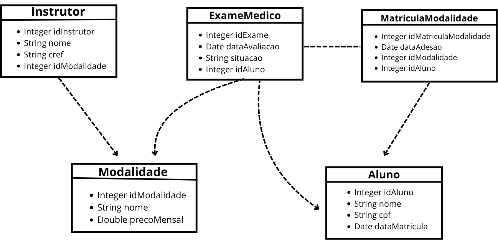

# Sistema de Gestão de Centro Esportivo

**Instituição:** Instituto Federal de Educação, Ciência e Tecnologia de São Paulo – IFSP Jacareí  
**Curso:** Tecnologia em Análise e Desenvolvimento de Sistemas (TADS)  
**Disciplina:** Banco de Dados 2  
**Ano Letivo:** 2026  

---

## Visão Geral

Este projeto é uma **aplicação interativa completa em Python para terminal** desenvolvida para gerenciar um Centro Esportivo. A aplicação implementa com total fidelidade o Modelo Entidade-Relacionamento (DER), o Diagrama de Classes e o Modelo Relacional especificados nos documentos e slides da disciplina.

---

## Arquitetura em 4 Camadas

A arquitetura do sistema segue rigorosamente o modelo documentado na apresentação (Slide 4 e `image.png`):

```
       ┌─────────────────────────────┐
       │      InteracaoUsuario       │  <--- Camada de Apresentação (CLI no Terminal com tabelas e menus)
       └──────────────┬──────────────┘
                      │
                      ▼
       ┌─────────────────────────────┐
       │         Controlador         │  <--- Camada de Negócio (Validações de CPF, CREF, datas e regras)
       └──────┬──────────────────────┘
              │  Manipula instâncias das Classes de Domínio:
              │  (Modalidade, Instrutor, Aluno, MatriculaModalidade, ExameMedico)
              ▼
       ┌─────────────────────────────┐
       │AdaptadorMapaObjetoRelacional│  <--- ORM / Persistência (Serialização, desserialização e SQL)
       └──────────────┬──────────────┘
                      │  Elimina a incompatibilidade de impedância
                      ▼
       ┌─────────────────────────────┐
       │       SGBD Relacional       │  <--- SQLite integrado (centro_esportivo.db) e script MySQL 8
       └─────────────────────────────┘
```

1. **Camada de Apresentação (`InteracaoUsuario`)**:
   - Menus navegáveis no terminal.
   - Tabelas alinhadas em formato ASCII/Unicode.
   - Cores e destaques visuais via códigos ANSI.
   - Validações interativas de entrada e tratamento amigável de erros.

2. **Camada de Controle (`ControladorCentroEsportivo`)**:
   - Aplica as regras de negócio antes de persistir dados.
   - Valida unicidade de CPF e CREF.
   - Assegura integridade nas relações (1:1 no laudo médico, N:N sem duplicidade de matrículas, 1:N com integridade de modalidade).
   - Traduz violações de integridade relacional em mensagens claras para o usuário.

3. **Camada de Domínio (Classes de Entidade)**:
   - `Modalidade` (`id_modalidade`, `nome_modalidade`, `preco_mensal`)
   - `Instrutor` (`id_instrutor`, `nome_instrutor`, `cref`, `id_modalidade`)
   - `Aluno` (`id_aluno`, `nome_aluno`, `cpf`, `data_matricula`)
   - `MatriculaModalidade` (`id_matricula_modalidade`, `data_adesao`, `id_modalidade`, `id_aluno`)
   - `ExameMedico` (`id_exame`, `data_avaliacao`, `situacao`, `id_aluno`)

4. **Camada de Persistência (`AdaptadorMapaObjetoRelacional`)**:
   - Converte objetos Python em registros de tabelas relacionais e vice-versa (*Data Mapper / ORM*).
   - Mantém as chaves estrangeiras ativas com `PRAGMA foreign_keys = ON`.
   - Executa DDL, CRUDs, as 4 Seleções Complexas e testes acadêmicos.

---

## Modelo Relacional e Restrições de Integridade

O banco possui 5 tabelas com suas respectivas restrições:

| Tabela | Chave Primária | Chaves Estrangeiras | Regras e Restrições |
| :--- | :--- | :--- | :--- |
| **Modalidades** | `id_modalidade` (PK Auto) | - | `CHECK (preco_mensal >= 0)` |
| **Alunos** | `id_aluno` (PK Auto) | - | `UNIQUE (cpf)` de 11 dígitos |
| **Instrutores** | `id_instrutor` (PK Auto) | `id_modalidade` $\rightarrow$ Modalidades | `UNIQUE (cref)`, `ON DELETE RESTRICT` (impede remoção de modalidade que possui instrutor) |
| **ExamesMedicos** | `id_exame` (PK Auto) | `id_aluno` $\rightarrow$ Alunos | `UNIQUE (id_aluno)` (estritamente 1:1), `CHECK (situacao IN ('Apto', 'Inapto'))`, `ON DELETE CASCADE` |
| **MatriculasModalidades** | `id_matricula_modalidade` (PK Auto) | `id_modalidade` e `id_aluno` | `UNIQUE (id_aluno, id_modalidade)` (impede matrícula duplicada no mesmo esporte), `ON DELETE CASCADE` |

---

## Como Executar a Aplicação

A aplicação utiliza apenas bibliotecas padrão do Python (como `sqlite3`), **não exigindo nenhuma dependência externa**.

### No Terminal (PowerShell ou Prompt de Comando):

```powershell
python app.py
```

Ao iniciar, se o banco `centro_esportivo.db` ainda não existir, ele será **automaticamente criado e populado com os 27 registros oficiais dos slides**.

---

## Funcionalidades do Sistema

No menu principal, você terá acesso a:

1. **Gestão de Modalidades Esportivas**:
   - Listagem com preços em Reais (`R$`).
   - Cadastro com validação de preço positivo.
   - Edição de nome e valor.
   - Exclusão com teste da proteção `ON DELETE RESTRICT`.
2. **Gestão de Instrutores (1:N)**:
   - Listagem com CREF e modalidade vinculada.
   - Cadastro com validação de CREF único e modalidade existente.
   - Atualização de nome, CREF e modalidade.
   - Exclusão de instrutores.
3. **Gestão de Alunos**:
   - Listagem formatada com CPF mascarado (`000.000.000-00`).
   - Cadastro com validação de 11 dígitos e unicidade.
   - Atualização cadastral.
   - Exclusão de aluno com verificação do **Efeito Cascata (`ON DELETE CASCADE`)** nas matrículas e laudo médico.
4. **Gestão de Matrículas (N:N Associativa)**:
   - Listagem de matrículas ativas com valor e data de adesão.
   - Efetivação de nova matrícula com prevenção de duplicidade.
   - Cancelamento de matrícula específica.
5. **Gestão de Exames Médicos (1:1)**:
   - Listagem com status destacados em cores (`Apto` em verde, `Inapto` em vermelho).
   - Lançamento/atualização de laudo garantindo que cada aluno tenha no máximo 1 exame.
   - Remoção de laudo.
6. **Relatórios & Seleções Complexas (As 4 Consultas de BD2)**:
   - **Consulta 1:** Ficha Geral de Alunos com Exame Apto (cruzamento de 5 tabelas).
   - **Consulta 2:** Auditoria Médica Preventiva (Alunos Inaptos em Atividades Físicas).
   - **Consulta 3:** Faturamento Estimado e Quantidade de Alunos por Modalidade (`LEFT JOIN`, `GROUP BY`, `HAVING`).
   - **Consulta 4:** Alunos Multidisciplinares e Mensalidade Acumulada (`GROUP BY`, `HAVING > 1`, `GROUP_CONCAT`, `SUM`).
7. **Laboratório de Testes dos Slides**:
   - Execução automática dos 3 `UPDATE`s do Slide 15.
   - Execução automática dos 2 `DELETE`s do Slide 16 com auditoria da exclusão em cascata.
   - Opção para resetar e restaurar o banco ao estado inicial dos 27 registros.
8. **Visualizador do Script SQL (`centro_esportivo.sql`)**:
   - Exibe o script oficial formatado para MySQL 8 pronto para entrega.
9. **Diagramas e Arquitetura**:
   - Exibe no terminal o resumo explicativo das camadas e integridade relacional.

---

## Diagramas

| Diagrama | Arquivo |
| :--- | :--- |
| DER Conceitual | [`diagramas/01_der_conceitual.png`](diagramas/01_der_conceitual.png) |
| Modelo Lógico Relacional | [`diagramas/02_modelo_logico_relacional.png`](diagramas/02_modelo_logico_relacional.png) |
| Diagrama de Classes | [`diagramas/03_diagrama_de_classes.png`](diagramas/03_diagrama_de_classes.png) |
| Arquitetura de Persistência | [`diagramas/04_arquitetura_persistencia.png`](diagramas/04_arquitetura_persistencia.png) |



---

## Arquivos no Projeto

- [`app.py`](app.py): aplicação principal em Python com as 4 camadas (seleção, inserção, atualização e remoção).
- [`centro_esportivo.sql`](centro_esportivo.sql): script completo em MySQL 8 (criação das tabelas, INSERT, 4 seleções complexas, UPDATE e DELETE).
- [`diagramas/`](diagramas/): DER, modelo lógico, diagrama de classes e arquitetura de persistência.
- `Relatório Trabalho - Sistema Centro Esportivo.pdf`: relatório técnico do trabalho.

### Como rodar o script SQL no MySQL

```bash
mysql -u root -p < centro_esportivo.sql
```
